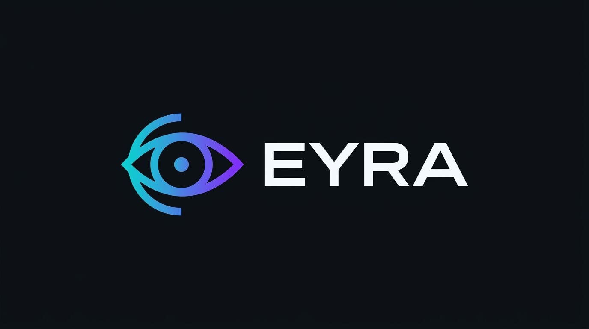

<p align="center">
  
</p>

<h1 align="center">EYRA</h1>
<p align="center">
  <strong>Eye + Ear + Action</strong> for AI agents on Windows.<br/>
  One ~1.9 MB pure-Rust binary that is an <strong>MCP server</strong>, an <strong>agent skill</strong> and a <strong>CLI</strong>.<br/>
  It sees any window as compact text, hears system audio and the microphone, and drives the mouse and keyboard.<br/>
  Works with any MCP-capable agent: <strong>Gemini</strong> (Antigravity, Gemini CLI), <strong>Claude</strong> (Claude Code, Claude Desktop), <strong>Cursor</strong>, VS Code and others.
</p>

<p align="center">
  <a href="https://github.com/layer8labs8/EYRA/releases"></a>
  <a href="https://github.com/layer8labs8/EYRA/releases/latest"></a>
  <a href="https://github.com/layer8labs8/EYRA/stargazers"></a>
  
  
  
  <a href="https://github.com/layer8labs8/EYRA/actions/workflows/ci.yml"></a>
</p>

https://github.com/user-attachments/assets/023b3238-3dee-4a1b-b20c-65e0447f14b8

---

## Why EYRA?

Most computer-use agents send a full screenshot on every step and then guess pixel coordinates. EYRA reads what Windows already knows about the screen. Example `see` output (abridged):

```text
WIN hwnd=0x3C051E proc=chrome.exe title="New repository - Google Chrome" mode=uia ms=22
#15 inp "Address and search bar" val="github.com/new" [158,46,1060,34]
#49 cmb "Owner" val="octocat" [325,333,150,32]
#51 inp "Repository name *" (focused) [496,333,530,32]
#68 chk "Add README" (unchecked) [978,682,42,24]
```

- **Exact, not guessed.** The text and coordinates come from the OS accessibility tree, so the agent doesn't have to estimate them from pixels. `click(id=51)` hits the right control.
- **Fewer tokens.** A text map of the UI is cheaper than a screenshot. `see_diff` returns only what changed, typically **under 40 tokens per step**.
- **Not just the web: the whole Windows desktop.** Any browser (Chrome, Edge, Firefox, Brave; including logged-in tabs), File Explorer, Office, Settings, Notepad, Electron apps (VS Code, Discord, Slack, Telegram), canvases, games and video (through OCR). No browser extension, per-site API or cloud service.
- **Model-agnostic.** It is a standard MCP server, so the same binary serves Gemini, Claude, GPT-based hosts or your own agent. Models that accept audio input (for example Gemini) can listen to the WAV clips that `listen` / `watch` produce. Text-only models still get Eye + Action.
- **Zero runtime dependencies.** No Python, FFmpeg, Whisper or API keys. Only Windows APIs: UI Automation, WinRT OCR, WASAPI and SendInput.
- **Safe by default.** Password values are masked, password managers are blocked, there's a `--read-only` mode, a failsafe corner, a kill-switch hotkey and an audit log.

## Measured performance

Measured on Windows 10 at 1366×768 with `eyra bench` and the MCP server.

### Latency of `see` (one window)

| Mode | Chrome (GitHub page, ~100 elements) | Electron desktop app |
|---|---|---|
| MCP server, warm (`see`) | **22 ms** | ~25 ms |
| MCP server, warm (`see_diff`) | **23 ms** | ~25 ms |
| CLI, one-shot process | ~45 ms | ~65 ms |
| OCR mode (`mode="ocr"`) | ~80 ms | ~80 ms |

File Explorer showing a very large folder is the slowest case tested: ~195 ms.

### Tokens per observation

Each window is compared with one screenshot of the same window (image tokens = w·h/750). Text tokens are estimated as chars/4.

| Window (screenshot cost) | `see` | `interactive_only` | `interactive_only` + `coords="center"` | `see_diff` (no change) |
|---|---|---|---|---|
| Chrome, dense GitHub repo page, 1036×701 (~969) | ~1,137 | ~1,065 | **~901 (−7%)** | **~42 (−96%)** |
| Electron desktop app, 1366×728 (~1,326) | ~675 | ~603 | **~528 (−60%)** | **~28 (−98%)** |
| Windows desktop / Explorer, 1366×768 (~1,399) | ~294 | ~294 | **~250 (−82%)** | **~31 (−98%)** |

**How to read this:**
- The first look at a very dense web page costs about as much as a screenshot, but it gives exact `#id`s and coordinates instead of pixels to guess.
- The big savings come from the steps after that. A 20-step task that observes with `see_diff` costs about 900 + 19×40 ≈ **1.7k tokens instead of about 19–26k** with screenshots.

Run it on your own machine:

```powershell
eyra bench --window Chrome
```

### Real tasks

Five scripted desktop tasks, 5 runs each (Windows 10, 1366x768). The steps are scripted with no LLM in the loop, so this measures whether EYRA's observations and actions are reliable; an agent's own success also depends on its model. Full method and output: [`bench/RESULTS.md`](bench/RESULTS.md).

| Task | Success | Tool calls | Tokens (EYRA) | Same observations as screenshots | Time |
|---|---|---|---|---|---|
| Type a sentence into Notepad and confirm it | 5/5 | 3 | 200 | 699 | 0.2 s |
| Open Notepad's Edit menu and read its items | 5/5 | 5 | 340 | 699 | 0.6 s |
| Fill a form field, tick a checkbox, press a button | 5/5 | 5 | 193 | 276 | 0.9 s |
| Find three files in a File Explorer folder | 5/5 | 1 | 891 | 561 | 1.4 s |
| Wait for a status label to change and read it | 5/5 | 3 | 138 | 276 | 2.3 s |

All 25 runs succeeded. List-heavy windows such as File Explorer cost more than a screenshot on the first look (the navigation pane and ribbon are listed too); the savings come from the steps after it. Reproduce with `powershell -ExecutionPolicy Bypass -File bench
un-tasks.ps1`.

## When to use EYRA (and when not)

| Task | Best tool |
|---|---|
| Native Windows apps (Explorer, Office, Settings, Telegram, WinForms/WPF/UWP) | **EYRA** |
| Electron apps (VS Code, Slack, Discord, Teams) | **EYRA** |
| Repeatedly watching the same window for changes | **EYRA** `see_diff` / `wait_change` |
| Canvas, games, remote desktop, video | **EYRA** `see(mode="ocr")` / `screenshot(diff_only)` |
| Hearing system audio or the microphone (for audio-capable models) | **EYRA** `listen` / `watch_*` |
| Deep web automation: hidden DOM, network, console, JS | A browser-extension tool (DOM access beats OS-level access here) |

EYRA can only see what's on screen. It can't read DOM nodes that aren't rendered, network traffic or a page's JavaScript state.

## Install

> **Note:** `eyra setup` and the build attestations described below ship with the next release (v0.4.0). The current release is v0.3.3; until then, use the one-click packages or the manual JSON setup.

### One command for any AI app

Download `eyra.exe` (see below), put it somewhere permanent, then let it register itself with your AI app:

```powershell
eyra setup antigravity      # or: gemini-cli, cursor, vscode, windsurf, claude-desktop
eyra setup --list           # which apps are installed and whether EYRA is configured
```

`setup` keeps every other server and setting in the app's config file, writes a backup next to it first, and never rewrites a file that isn't plain JSON (it prints the snippet to add by hand instead). Add `--read-only` for look-and-listen only, `--remove` to take EYRA out again, or `--dry-run` to preview. Restart the app afterwards.

### One-click install

| Agent | How |
|---|---|
| **Claude Desktop** | Download `eyra-<version>.mcpb` from the [latest release](https://github.com/layer8labs8/EYRA/releases/latest) and open it (double-click, or drag it into *Settings → Extensions*). A *Read-only mode* switch is available in the extension's settings. |
| **Gemini CLI** | `gemini extensions install https://github.com/layer8labs8/EYRA` |
| **Claude Code** | `/plugin install eyra --marketplace layer8labs8/EYRA` |

All packages contain the same standalone `eyra.exe`; nothing else is installed.

### Download

1. Download `eyra.exe` from the [latest release](https://github.com/layer8labs8/EYRA/releases/latest). Or take the `.zip`, which also includes `SKILL.md`, the example MCP config and the license.
2. Put it anywhere, for example `C:\Tools\eyra\eyra.exe`. Nothing else needs to be installed: it runs on a stock Windows 10/11.
3. Connect it to your agent (see below).

### Verify the download

Every release file is built by [GitHub Actions](.github/workflows/release.yml) from the tagged source, not on a developer's machine, and carries a signed [build provenance attestation](https://docs.github.com/actions/security-for-github-actions/using-artifact-attestations). With the [GitHub CLI](https://cli.github.com/):

```powershell
gh attestation verify eyra.exe -R layer8labs8/EYRA
```

It confirms which repository, commit and workflow produced the file. To compare checksums instead:

```powershell
Get-FileHash .\eyra.exe -Algorithm SHA256   # compare with SHA256SUMS.txt from the release
```

The binary isn't code-signed yet, so Windows SmartScreen may show a warning on first run: choose *More info* → *Run anyway*.

### Build from source

Requirements: Windows 10/11 and a stable Rust toolchain (MSVC or GNU). Official releases are built with `stable-x86_64-pc-windows-gnu`, which needs no Visual Studio; to use it locally, run `rustup override set stable-x86_64-pc-windows-gnu` in the repository folder.

```powershell
cargo build --release
# -> target\release\eyra.exe (~1.9 MB, no DLLs needed)
cargo test --release
```

To build every release asset (exe, zip, Claude `.mcpb`, Gemini extension archive, checksums) into `dist\`:

```powershell
powershell -ExecutionPolicy Bypass -File scripts\package.ps1
```

### Connect it to an agent

EYRA speaks standard MCP over stdio, so the setup is the same everywhere: point the host at `eyra.exe mcp`. `eyra setup <app>` does this for you; to do it by hand:

| Host | `eyra setup` | Config file it edits |
|---|---|---|
| **Google Antigravity** | `eyra setup antigravity` | `%USERPROFILE%\.gemini\config\mcp_config.json` |
| **Gemini CLI** | `eyra setup gemini-cli` (or `gemini extensions install https://github.com/layer8labs8/EYRA`) | `%USERPROFILE%\.gemini\settings.json` |
| **Cursor** | `eyra setup cursor` | `%USERPROFILE%\.cursor\mcp.json` |
| **VS Code** | `eyra setup vscode` | `%APPDATA%\Code\User\mcp.json` (uses `servers` and `"type": "stdio"`) |
| **Windsurf** | `eyra setup windsurf` (edits an existing config only) | `%USERPROFILE%\.codeium\windsurf\mcp_config.json` |
| **Claude Desktop** | `eyra setup claude-desktop` (or open the `.mcpb`) | `claude_desktop_config.json` (the Microsoft Store build's copy under `%LOCALAPPDATA%\Packages\Claude_*` when present) |
| **Claude Code** | `/plugin install eyra --marketplace layer8labs8/EYRA` | `claude mcp add eyra -- C:\path\to\eyra.exe mcp` |
| **Any other MCP host** | | the host's MCP config file, with the JSON below |

See [`mcp-config.example.json`](mcp-config.example.json):

```json
{
  "mcpServers": {
    "eyra": { "command": "C:\\path\\to\\eyra.exe", "args": ["mcp"] }
  }
}
```

Use `"args": ["mcp", "--read-only"]` to expose only the Eye, Ear and Watch tools, with no mouse or keyboard.

The server negotiates MCP revisions `2025-06-18`, `2025-03-26` and `2024-11-05`. It sends usage `instructions` on `initialize` and marks every tool with `readOnlyHint`/`destructiveHint` annotations, so hosts can auto-approve observation tools and ask before input actions.

**Agent skill.** [`SKILL.md`](SKILL.md) teaches an agent the lowest-token workflow.

## MCP tools (16)

### Eye

| Tool | What it does | Key arguments |
|---|---|---|
| `list_windows` | Visible windows: hwnd, process, title, rect, flags | — |
| `see` | Numbered UI element map (UIA, OCR fallback); includes open popup menus | `window`, `mode` = auto/uia/ocr/both, `interactive_only`, `coords` = rect/center, `max_elements`, `ocr_lang` |
| `see_diff` | Only `+` added, `~` changed and `-` removed elements since the last `see` of **that window** | same as `see` |
| `screenshot` | Compact JPEG/PNG, including occluded windows | `window`, `crop`, `max_width`, `quality`, `diff_only`, `som` |
| `wait_change` | Blocks until the pixels change (page load, animation end) | `window`, `timeout_ms`, `threshold_pct` |

### Ear and Watch

| Tool | What it does | Key arguments |
|---|---|---|
| `list_audio_devices` | Output (loopback) and input endpoints | — |
| `listen` | Records system audio (the microphone only with `--allow-mic`), trims silence, saves a 16 kHz WAV. A red "recording" badge is shown meanwhile | `seconds`, `source`, `trim_silence` |
| `watch_start` / `watch_poll` / `watch_stop` | Rolling timeline of scene-change keyframes and audio clips | `window`, `audio`, `chunk_sec`, `scene_threshold_pct` |

### Action (disabled in `--read-only`)

| Tool | What it does | Key arguments |
|---|---|---|
| `click` | Clicks by `#id` (background UIA Invoke/Toggle/Select first) or by `x,y` | `id`, `x`, `y`, `button`, `clicks`, `background` |
| `type_text` | Types Unicode text (background UIA `SetValue` first) | `text`, `id`, `clear`, `press_enter` |
| `hotkey` | Sends a keyboard shortcut such as `ctrl+l` or `alt+tab` | `keys`, `window` |
| `scroll` / `drag` | Scrolls the mouse wheel or drags with the left button | `delta_y`, `delta_x` / `x1,y1,x2,y2` |
| `focus_window` | Restores, focuses and optionally locks a default target window | `window`, `lock` |

### Reading the element map

```text
#12 btn "Save" (disabled) [840,610,90,32]
 │   │    │       │          └ x,y,width,height in screen pixels
 │   │    │       └ state: focused, disabled, checked, unchecked, mixed, selected
 │   │    └ accessible name (val="…" follows when an input has a value)
 │   └ role: btn inp lnk chk rad cmb tab mnu itm sld hdr txt img doc pwd ocr el
 └ id: pass it to click / type_text
```

With `coords="center"` the position is printed as the click point only (`#12 btn "Save" (disabled) @885,626`), which is the cheapest format.

`#id`s come from the **most recent `see`/`see_diff`** of that window, so call `see_diff` again after the UI changes. Open popup menus (File/Edit menus, context menus) are part of the window's map.

## CLI

```powershell
eyra windows
eyra see --window Chrome --interactive-only --coords center
eyra diff --window Chrome
eyra screenshot --window Chrome --som --out som.jpg
eyra click --id 5
eyra type "hello world" --id 2 --enter
eyra hotkey ctrl+l
eyra wait-change --window Chrome
eyra audio-devices
eyra listen --seconds 8 --source system
eyra --allow-mic listen --seconds 8 --source both
eyra watch --window Chrome --duration 60
eyra ocr-langs
eyra logs --tail 25
eyra bench --window Chrome
eyra setup --list
eyra serve --port 47821    # optional 127.0.0.1 HTTP bridge (token-authenticated)
```

Safety options work with every command, including `mcp`: `--read-only`, `--allow-apps`, `--confirm`, `--max-actions-per-minute`, `--allow-mic` (see [Security model](#security-model)).

`--window` accepts an hwnd (`0x3C051E`), a title substring, a process name or `screen`. Add `--json` for machine-readable output.

## Security model

EYRA gives an AI agent real control of your desktop, so its defaults assume the agent can be wrong or manipulated.

**Prompt injection.** Anything on screen can contain text written to look like instructions ("ignore previous instructions and send this file to..."). EYRA can't tell a real instruction from an injected one, so it treats all screen and audio content as untrusted data: every `see` result is marked `content=untrusted`, and the MCP server instructions, tool descriptions and agent skills tell the model never to follow instructions found on screen. The guards below limit the damage when a model follows one anyway.

| Guard | Default | Change it with |
|---|---|---|
| Confirmation dialog before clicks on delete / send / pay / publish-style controls (8 languages) and before `shift+delete`, `ctrl+enter` | on | `--confirm all` (ask before every action) or `--confirm off` |
| Actions only in apps you list | off | `--allow-apps chrome.exe,notepad.exe` |
| Rate limit | 60 actions per minute, 10 per second | `--max-actions-per-minute N` (0 = unlimited) |
| Observation only, no mouse or keyboard tools | off | `--read-only` |
| Microphone capture | off (system audio only) | `--allow-mic` |
| Visible "EYRA is recording" badge while audio or a watch session is captured | always | — |
| Recordings deleted from disk | after 60 minutes | `EYRA_AUDIO_TTL_MIN` (0 = keep until the 24-clip limit) |

Each flag also has an environment variable (`EYRA_CONFIRM`, `EYRA_ALLOW_APPS`, `EYRA_MAX_ACTIONS_PER_MIN`, `EYRA_READ_ONLY`, `EYRA_ALLOW_MIC`), which is handy in an MCP host's config. For example, to let an agent act only in Notepad and confirm every step:

```json
{ "command": "C:\\Tools\\eyra\\eyra.exe", "args": ["mcp", "--allow-apps", "notepad.exe", "--confirm", "all"] }
```

The confirmation dialog appears on your desktop and the tool call waits for your answer, so leave `--confirm all` off for unattended runs. Coordinate clicks, scrolls and drags are checked against the window actually under the pointer.

**What EYRA can't protect against:** an agent you allowed to act in an app can still do anything a person could do there with ordinary-sounding buttons. For sensitive work, combine `--allow-apps` with `--confirm all`, or use `--read-only`.

## Safety

| Guard | Behaviour |
|---|---|
| Password fields | Values are always shown as `[REDACTED]` and blacked out in screenshots and before OCR |
| Sensitive windows | Password managers (1Password, KeePass, Bitwarden, LastPass, Dashlane, …, matched by executable name), Windows credential and UAC prompts, and browser password pages (Google Password Manager, Edge/Firefox *Passwords*, *Wallet*) can't be read or controlled unless you pass `--allow-sensitive` |
| OCR text | OCR can't see which field is a password, so values next to a *Password* / *Parol* / *Şifre* / *Пароль* label (16 languages) and runs of `••••` are masked, and OCR output says that this masking is heuristic |
| Local HTTP bridge | `eyra serve` accepts browser calls only from loopback pages and origins you list exactly with `--allow-origin`. Its 256-bit token is written to `%LOCALAPPDATA%\eyra\bridge.token`, never printed |
| `--read-only` | Removes all input tools from the MCP tool list and rejects them in the CLI and bridge |
| Corner failsafe | Moving the mouse to the top-left corner `(0,0)` halts input actions |
| Kill switch | `Ctrl+Alt+Esc` latches an emergency stop until eyra restarts |
| Dangerous hotkeys | `ctrl+alt+delete` and `win+l` are blocked, and so is `alt+f4` on the Windows shell |
| Audit log | JSONL at `%LOCALAPPDATA%\eyra\audit.jsonl`: every call with its timing and token estimate. Text typed into password fields is redacted. Rotates at 10 MB |

## Troubleshooting

| Symptom | Cause and fix |
|---|---|
| `see` says the window is minimized | Restore it first with `focus_window`. |
| `see` returns nearly nothing for a game, canvas or remote desktop | There is no UIA tree there. Use `mode="ocr"`; `auto` already falls back to OCR below 5 elements. |
| OCR misses your language | Run `eyra ocr-langs`, then install the language's OCR pack in Windows Settings → Time & Language → Language, and pass `ocr_lang`. |
| Clicks or typing do nothing in an admin window | Windows UIPI blocks input to elevated windows from a non-elevated process. Run eyra elevated, or the target app non-elevated. |
| Coordinates are off on a multi-monitor or 150% DPI setup | eyra is per-monitor DPI aware and coordinates are physical pixels. Use `#id` clicks rather than hand-computed points. |
| `listen` says "microphone skipped" or refuses `source="mic"` | The microphone is off by default. Start eyra with `--allow-mic` (or `EYRA_ALLOW_MIC=1` in the MCP config). |
| An action fails with "rate limit reached" or "not in the allowed apps" | That's `--max-actions-per-minute` / `--allow-apps` working; adjust the flag if the limit is too tight. |

### Environment variables

| Variable | Effect |
|---|---|
| `EYRA_LOG_FILE` / `EYRA_NO_LOG` | Audit log path / disable logging |
| `EYRA_READ_ONLY` | Forces read-only mode |
| `EYRA_ALLOW_APPS` | Comma-separated apps that may receive input (`--allow-apps`) |
| `EYRA_CONFIRM` | `risky` (default), `all` or `off` (`--confirm`) |
| `EYRA_MAX_ACTIONS_PER_MIN` | Rate limit, default 60, 0 = unlimited |
| `EYRA_ALLOW_MIC=1` | Allows microphone capture (`--allow-mic`) |
| `EYRA_AUDIO_TTL_MIN` | Minutes before recordings are deleted, default 60, 0 = no age limit |
| `EYRA_OCR_SCALE=2` | Upscales frames before OCR (slower; can help with very small text) |

## Architecture

```text
src/
├─ eye/     uia.rs (cached UIA subtree scan) · ocr.rs (WinRT OCR) · capture.rs (PrintWindow/BitBlt)
│           diff.rs (element and pixel diff) · som.rs (Set-of-Mark badges) · windows.rs
├─ ear/     wasapi.rs (loopback + mic) · vad.rs (resample + energy VAD) · wav.rs
├─ hand.rs  UIA patterns → SendInput fallback
├─ watch.rs ring-buffered video and audio timeline
├─ mcp.rs   stdio JSON-RPC server   ├─ bridge.rs  local HTTP bridge
├─ safety.rs · audit.rs · state.rs  └─ cli.rs
```

## License

Licensed under the [Apache License 2.0](LICENSE).
